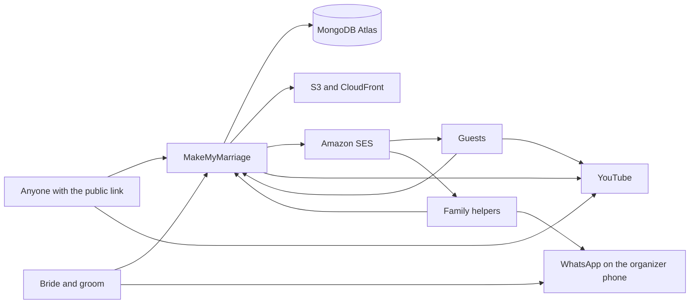
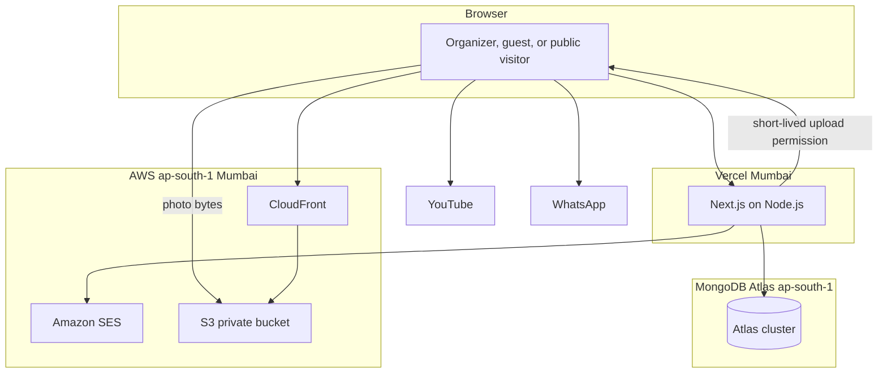
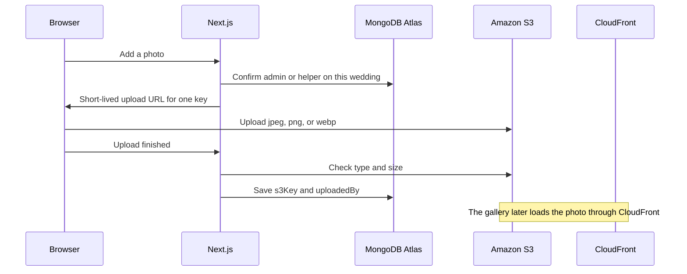
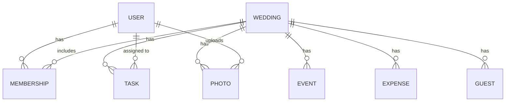
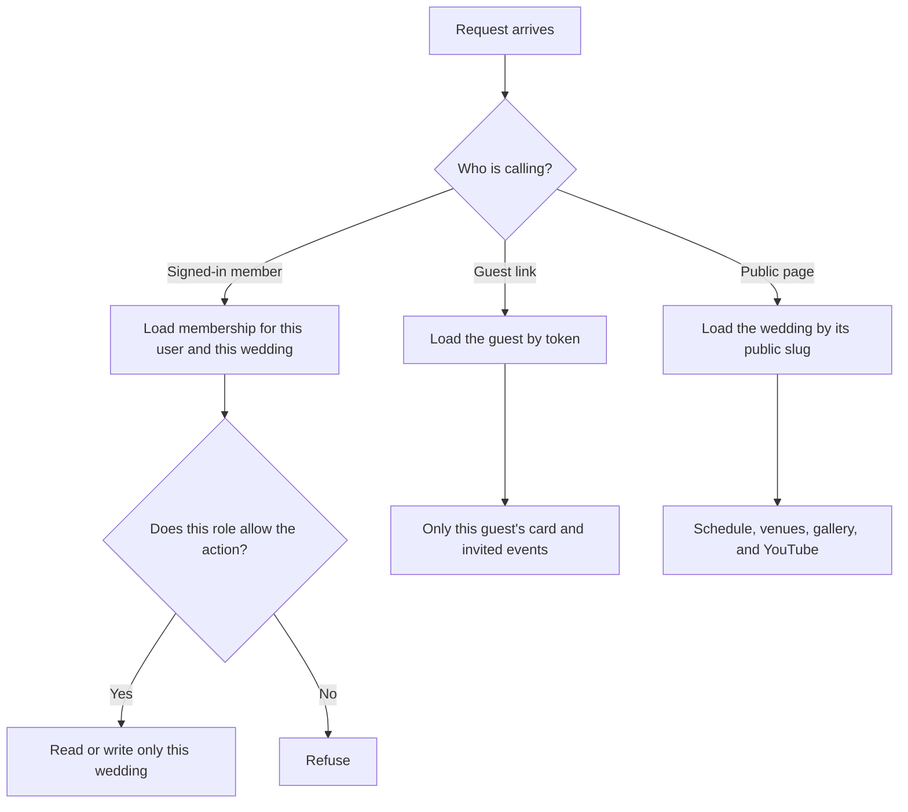

# MakeMyMarriage — version one architecture

This is the architecture we recommend from your preferences. It covers version one only: one North Indian Hindu wedding per family, shared by the bride, the groom, and their helpers, with a personal invitation for each guest.

These choices are locked:

- One monolithic application, not microservices.
- Frontend: Next.js with TypeScript.
- Backend: Next.js Route Handlers running on Node.js, in the same app. No second server.
- Database: MongoDB Atlas (the managed cluster on MongoDB.com).
- Validation: Zod, on every Route Handler, before a write.
- Photos: Amazon S3. CloudFront serves them to the app and the public page.
- Host: Vercel.
- Email delivery: Amazon SES, sent in batches.
- Family sign-in: our own email-and-password auth. No third-party auth. A server-side session in Atlas, and a JWT in an httpOnly cookie that points at that session.

A family invite is a unique link, not a match on name and date. The person clicks it and lands on the site. If they have no account, they create one with email and password, then log in. If they already have an account, they log in. After login, that one wedding is linked to them.

Version one is sized for about 500 people and about 1000 photos on a single wedding.

## 1. Family invite

Nothing else in this design is waiting on a decision.

1. An admin invites a family member by email.
2. The server creates a long random invite token on that membership. The token is unique in the database.
3. SES sends a link that contains only that token.
4. They click the link and land on the site. The server loads the membership by the token. It does not search by couple name, person name, or wedding date.
5. If they have no account, they create one with email and password, then log in with it.
6. If they already have an account, they log in.
7. The account email must be the invited email. After login, that membership is linked to that user. Two weddings with the same names and the same date stay separate, because each link is its own token.

## 2. What we are building

One repository. One deployable Next.js application, written in TypeScript, using the App Router, running on Node.js. The screens and the backend live in that one app. Pages render the product. Route Handlers and server-side modules are the backend: they check who is calling, validate the input with Zod, read and write Atlas, and talk to S3 and SES.

That is the monolith. There is no second service to deploy, and no public API for other apps to call. The Route Handlers exist for this product’s own screens.

Many families can each plan their own wedding. Each wedding is one workspace. The bride’s side and the groom’s side share it. A person can belong to more than one wedding, and the home screen lists only the weddings they belong to, with the dates of each. Every read and write for a wedding is limited to that wedding’s id and to what the caller is allowed to do.

A new wedding starts with seven events, in this order: roka / engagement, haldi, mehendi, sangeet, wedding ceremony, reception, vidaai. Admins and helpers can change that list. The wedding has one invitation design. The card is a web page. Personalization is the guest’s name and the events they are invited to, filled in when the page renders.

## 3. System context

The couple and their helpers use the signed-in app. Guests open a link from email and never create an account. Anyone can open the public wedding page. YouTube hosts the video. WhatsApp is the organizer’s own phone, opened with a share link. MakeMyMarriage does not sit in the middle of that chat.

## 4. Containers

**Browser.** The couple, helpers, guests, and public visitors all use the same site. Organizer screens require a session. The guest card requires the token in the link. The public page requires neither.

**Next.js on Node.js, hosted on Vercel.** One project, one app. Route Handlers run on the Node.js runtime, which is what the MongoDB driver and the AWS SDK require. Server functions run in Vercel’s Mumbai region (`bom1`), next to the data.

**MongoDB Atlas.** One cluster in `ap-south-1`, one database for the app. Users, weddings, and every list that belongs to a wedding live here. Sessions live here too.

**Amazon S3.** A private bucket in `ap-south-1`. It stores photo bytes and nothing else. The invitation is not an image. Video is not a file we store.

**CloudFront.** Sits in front of the bucket so the public wedding page and the in-app gallery can show photos. The bucket itself does not allow public access. CloudFront is the only reader, using an origin access control.

**Amazon SES.** In `ap-south-1`. It sends mail. The card the guest reads is a Next.js page, not the email body.

**YouTube and WhatsApp.** YouTube is an embed. WhatsApp is a `wa.me` link. Neither is a server we run.

## 5. Main flows

The server is the authority on every flow. Hiding a button is not the permission check. The Route Handler loads the caller, decides whether that role may do the thing, and then reads or writes only that wedding.

### Sign up and create a wedding

1. A person signs up with their name, email, and password. The password is stored as a one-way hash. The password itself is never stored. This auth is ours. No Auth.js, Clerk, or other auth vendor.
2. The server writes a session in Atlas and sets an httpOnly cookie. The cookie holds a JWT. The JWT carries the session id, not the user’s role or wedding list. Each request checks the JWT, then loads that session. Signing out deletes the session, so the JWT stops working.
3. Home lists weddings for that user. A new person sees an empty list.
4. They create a wedding: the couple’s names, the wedding dates, and whether they are the bride or the groom.
5. The server writes the wedding, an admin membership for the creator, and the seven default events in order. Event date, time, and venue start empty and are filled in as the family plans.
6. They invite their partner by the same family-invite link. The partner creates an account if they need one, logs in, and joins the same wedding. Both are admins and can do everything in it.

A forgotten-password email, also sent with SES, lets them set a new password. That mail is part of email-and-password sign-in.

### Add a helper

1. An admin enters the helper’s name, email, and relation. The relation is mother, father, brother, sister, or other.
2. The server writes a helper membership on that wedding. This is the family record: name, email, relation, and the wedding they belong to.
3. The server creates a long random invite token on that membership and SES emails a link that contains only that token. The same names and the same wedding date never decide which wedding they join.
4. They click the link and land on the site. If they have no account, they create one with email and password, then log in. If they already have an account, they log in.
5. The account email must be the invited email. After login, the membership is linked to their user. The wedding appears on their home list with its dates.
6. An admin can remove a helper. That deletes the membership. The person’s login stays, in case they belong to another wedding. Expenses they already paid still show their name.

A helper cannot add or remove helpers, and cannot make someone an admin.

### Edit events

An admin or a helper can rename an event, change the order, add an event, or remove an event. Each event has its own date, time, and venue. The venue stores a name, a latitude, and a longitude. Times are India Standard Time so the card, the public page, and the family see the same local time.

The seven starting events are ordinary event documents. Changing the list edits those documents. Removing an event drops it from each guest’s invited events and from their replies. A guest cannot edit events.

### Tasks

An admin or a helper adds a task for the wedding and assigns it to an admin or a helper. Any admin or helper can accept a task. Status is open or accepted. The task list is the wedding’s list. Guests have no task list.

### Expenses

An admin or a helper sets a budget total on the wedding and adds expenses. Each expense has a category, an amount in rupees, who paid, and the amount still due. The category is venue, caterer, decor, clothes, ritual, or other. Who paid is a person in the wedding; the expense keeps their name if they later leave.

The wedding screen shows the budget total against the sum of the amounts, and the sum still due. Guest travel and stay are not recorded. The price of MakeMyMarriage is not an expense and has no field here.

### Add a guest and send the invitation

1. An admin creates the invitation wording: the couple and a short message. Those two fields live on the wedding. A helper cannot change them.
2. An admin or a helper adds a guest with a name and an email, and chooses which events that guest is invited to.
3. The server creates a long random token and stores it on the guest. The token is the guest’s only credential.
4. SES sends an email whose link points at that guest’s card, a Next.js page. The email leads them there. It is not the card itself.
5. The page uses one design for the whole wedding. It fills in that guest’s name and only their events, including each event’s date, time, and venue. Because the card is rendered, a later change to a venue shows up on the card. The wording of the couple and the message stays as the admin wrote it.
6. A reminder is a second email with the same link. It does not create a second card.

If SES fails, the guest stays saved and the send can be tried again.

### RSVP

The guest opens the link in a browser and does not sign in. They answer yes or no for each event they were invited to. The server accepts a reply only when the token matches and the event is on that guest’s list. Admins and helpers see the replies on the guest list, event by event.

The public wedding page does not collect RSVPs and does not ask a visitor to type an email. RSVP stays on the token link.

### Photo upload

The server chooses the object key under that wedding. The browser cannot write somewhere else. The photo document is written only after S3 has the object and the type and size are allowed. A failed upload leaves no gallery item.

### YouTube

An admin pastes a YouTube URL onto an event. The server checks that it is a YouTube address and stores it on that event. The app and the public page render YouTube’s own player for that URL. Helpers and guests can watch. They cannot set or change the URL. We do not upload video and we do not run a stream.

### WhatsApp share

On the schedule, on one event, or on one task, an admin or a helper presses share. The app opens `wa.me` with the text of that item: the schedule, that event’s name, date, time, and venue, or that task. The organizer picks the family chat on their own phone. There is no call to a WhatsApp API. The text never contains a guest token. Guests are not contacted on WhatsApp.

### Public wedding page

Anyone with the address can open it. It shows the schedule, the venue for each event, the gallery, and the embedded player for every event that has a YouTube URL. It does not show the guest list, replies, tasks, expenses, or the invitation wording editor.

## 6. Data model

Atlas holds separate collections. A wedding document describes the wedding. It does not contain the guest list, the photos, the events, the tasks, or the expenses. Those lists grow and are loaded on their own, so each one is its own collection, with `weddingId` on every document that belongs to a wedding.

**users.** The person who can sign in. Email, name, and the password hash. Email is unique. Guests are not users.

**sessions.** Our own records. A session points at a user and expires. The JWT in the cookie carries this session’s id. Signing out deletes the session. This is infrastructure, not a wedding record.

**weddings.** The workspace. Couple names, the invitation message, the wedding dates, the budget total in rupees, and a unique public slug for the wedding page. One invitation design means these fields plus the shared card page, not a stored image and not a copy of the card per guest.

**memberships.** `userId`, `weddingId`, `role` (`admin` or `helper`), `relation`, and an invite token. For the couple, relation is bride or groom. For a helper, relation is mother, father, brother, sister, or other. Until the invited person logs in, the membership holds their name, email, and invite token, and `userId` is empty. The invite link is that token. When they log in with that email, `userId` is set. Name and date are never used to find the wedding.

**events.** `weddingId`, name, `order`, date, time, venue name, latitude, longitude, and `youtubeUrl`. The URL is empty until an admin sets it. Latitude and longitude are empty until the family sets the place.

**tasks.** `weddingId`, title, `assigneeId`, and `status` (`open` or `accepted`). The assignee is an admin or a helper.

**expenses.** `weddingId`, category, amount, who paid, and the amount still due. Category is one of venue, caterer, decor, clothes, ritual, other.

**guests.** `weddingId`, name, email, token, the invited event ids, and a yes or no for each of those events. Also the time the invitation was sent and the time the reminder was sent, so the family can see that the mail went out. The token is a long random value, safe to put in a URL, and unique across the database.

**photos.** `weddingId`, `s3Key`, and `uploadedBy`. The bytes stay in S3. The public URL is built from the key and the CloudFront domain when a page renders.

Indexes that matter most:

| Index | Why |
|---|---|
| Membership by user | Home lists the weddings for the signed-in person |
| Guest token, unique | The invitation link must find exactly one guest |
| Guests by wedding | The guest list and the replies for one wedding |
| Events by wedding and order | The schedule in the order the family set |

Supporting indexes: unique email on users; unique public slug on weddings; unique invite token on memberships; unique wedding plus email on memberships and on guests, so the same person is not added twice; `weddingId` on tasks, expenses, and photos. A wedding is expected to hold about 500 people and about 1000 photos, so those lists are paged and are never embedded inside the wedding document. Unique session id on sessions.

## 7. Permissions

The client may send a wedding id. The server uses it only after it finds a membership for this user and that wedding. A guest request starts from the token, then stays inside that guest’s wedding and invited events. The public page loads a fixed public shape and nothing else.

| | Admins (bride and groom) | Helpers (family) | Guests |
|---|---|---|---|
| Shared wedding workspace | Yes | Yes | Their own card, and the public page |
| Add and remove helpers, and add the other admin | Yes | No | No |
| Create and edit the invitation card (couple and message) | Yes | No | No |
| Rename, reorder, add, and remove events | Yes | Yes | No |
| Add, assign, and accept tasks | Yes | Yes | No |
| See and handle budget and expenses | Yes | Yes | No |
| Add guests, choose their events, send the invitation and the reminder, see RSVPs | Yes | Yes | Open their own card and RSVP |
| Attach a YouTube URL to an event | Yes | No | Watch on the public page |
| Add photos | Yes | Yes | No |
| View the gallery | In the app | In the app | On the public page |
| WhatsApp share of the schedule, an event, or a task | Yes | Yes | No |
| Watch YouTube in the app | Yes | Yes | On the public page |

Helpers cannot add or remove helpers, cannot edit the invitation card wording, and cannot attach YouTube. Guests cannot see the budget, the guest list, or the tasks.

## 8. Images, email, video, and WhatsApp

**Images.** S3 stores photo bytes only. The bucket is private and blocks public access. An admin or helper asks the app for a presigned upload URL. That URL expires in a few minutes, allows one object key under that wedding, and accepts only jpeg, png, or webp, up to 10 MB. The browser uploads straight to S3. The app then checks the object and saves `s3Key` and `uploadedBy` in Atlas. CloudFront serves the gallery to the signed-in app and to the public page. There is one gallery per wedding. A wedding may hold about 1000 photos, so the gallery is paged. The page does not load every photo at once.

**Email.** SES sends the helper invite, the guest invitation, the reminder, and password reset. The guest mail contains the link to `/invite/<token>`. The family mail contains the link to `/join/<token>`. The card is the page, not the email body.

Sending to many people is a batch, not one request per person and not a second service. The app writes one pending row per recipient. It then asks SES for a bulk send of up to 50 at a time, and each recipient still gets their own token link. It marks each row sent or failed. Rows already sent are skipped if the batch is run again. A hundred guests is two batches. Five hundred is ten. The from-address is a verified domain. Production sending waits until that domain is verified and the SES account is out of the sandbox.

**Video.** `youtubeUrl` on the event is the whole integration. The page turns a normal YouTube link into the official embed and shows it in the app and on the public page. Empty URL means no player. YouTube hosts the live stream and the recording.

**WhatsApp.** The share button builds a `https://wa.me/?text=...` link in the browser. It carries the schedule, one event, or one task. Organizers only. No WhatsApp Business API, no template messages, and no guest delivery.

**Public site and invitation.** The public page is `/w/<slug>`. The invitation is `/invite/<token>`. One card template serves every guest. The slug is unique and meant to be shared. The token is a secret. It is not written into WhatsApp text, gallery URLs, or the public page.

## 9. Environments and configuration

Three environments: local, preview, and production. Each has its own Atlas database and its own S3 bucket, so a test guest or a test photo never lands in a real wedding. Production Atlas, S3, CloudFront, and SES are in `ap-south-1`. Preview and local use the same region.

Production deploys from the main branch of the one repository to one Vercel project. Preview deployments are the other branches.

Names only. Values live in Vercel’s environment settings and in a local env file that is not committed. No secrets in the repository.

| Name | Purpose |
|---|---|
| `MONGODB_URI` | Connection to that environment’s Atlas database |
| `AUTH_SECRET` | Signs the JWT in the session cookie |
| `APP_URL` | Base URL used in email links and WhatsApp text |
| `AWS_REGION` | `ap-south-1` |
| `AWS_ACCESS_KEY_ID` | Key id for the app’s IAM user |
| `AWS_SECRET_ACCESS_KEY` | Secret for that key |
| `S3_BUCKET` | Private photo bucket for this environment |
| `CLOUDFRONT_DOMAIN` | Host that serves gallery images |
| `SES_FROM_ADDRESS` | Verified from-address for invite, reminder, helper, and password mail |

The AWS key can upload and read objects in the one bucket and send email from the one verified address. It has no other access in the account. The session cookie is httpOnly and sent only over HTTPS.

## 10. What version one does not need

- **Microservices.** One Next.js app on Node.js is the whole product.
- **A separate API process.** No mobile client and no public API.
- **Our own streaming.** YouTube hosts the stream and the recording.
- **The WhatsApp Business API.** Organizers share from their own WhatsApp. Guests stay on email.
- **Redis.** Sessions live in Atlas. Mail sends while the organizer waits. There is no cache and no job queue to run.
- **Guest accounts.** The token in the invitation link is the only guest credential.

The same boundary keeps these out of the design: a payment system for the price of the app, guest travel and stay, a second workspace for each side of the family, a planner desk for a professional with many clients, any wedding tradition other than North Indian Hindu, and a choice of invitation themes. The price of MakeMyMarriage is still an open question. It is not a field on the wedding and not a line in the expenses.
