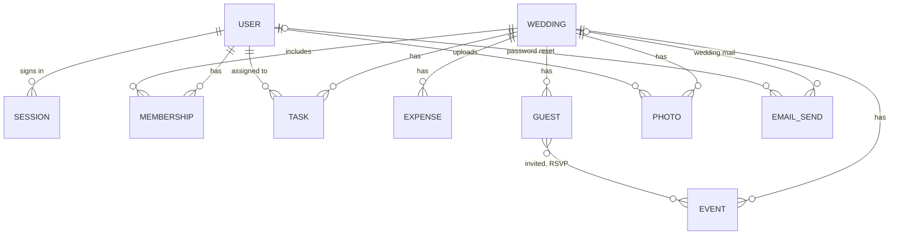

# MakeMyMarriage — version one database design

## Purpose

This is the database for version one. One MongoDB Atlas cluster in Mumbai (`ap-south-1`) holds one database. Local, preview, and production each have their own copy of that database, with the same collections, so a test guest or a test photo never lands in a real wedding.

Atlas stores the people who can sign in, their sessions, the weddings, and every list that belongs to a wedding. Amazon S3 stores photo bytes. Amazon SES sends the mail.

Route Handlers check each write with Zod before anything is saved. Zod checks the input. It is not a database product, and it does not store these records.

These collections are the whole version-one database:

`users`, `sessions`, `weddings`, `memberships`, `events`, `tasks`, `expenses`, `guests`, `photos`, `emailSends`.

A wedding is one shared workspace, sized for about 500 people and about 1000 photos. The guest list and the photos are their own collections. The wedding document does not contain them. Events, tasks, expenses, and memberships are their own collections too, each carrying that wedding’s id.

Money fields are whole rupees. A value of `250000` means 2,50,000 rupees. Event times are India Standard Time. A password is stored only as a one-way hash. The password itself is never written.

Every document has an id assigned by Atlas. When one record points at another, it stores that id. `weddingId` means the wedding’s id. `userId` means the user’s id.

## How the records connect

A person who can sign in has a user document and, while they are signed in, a session. Home finds their memberships, then reads the dates of those weddings. A membership is one person in one wedding. The same person can belong to more than one wedding.

The wedding points at nothing nested. Its lists point back at it with `weddingId`.

A family invite is a token on a membership. A guest invitation is a token on a guest. Neither lookup uses the couple’s names or the wedding dates. Two weddings with the same names and the same dates stay separate because each link is its own token.

The guest stores event ids for the events they are invited to, and their yes or no beside those ids. There is no extra collection between guests and events. An email row for a password reset has a user and no wedding. The other email rows have a wedding.

A wedding is opened in one of four ways:

- The signed-in app uses the wedding id, and only after it finds a membership for this user and that wedding.
- The public page uses the public slug (`/w/<slug>`).
- A family invite uses the invite token on a membership (`/join/<token>`), then that membership’s wedding id.
- A guest card uses the guest token (`/invite/<token>`), then that guest’s wedding id.

Couple names, a person’s name, and wedding dates are display fields. They are never the search.

## Users

A user is a person who can sign in: the bride, the groom, or a helper. Guests have no user document, no password, and no session.

| Field | Set | Holds |
|---|---|---|
| email | Required | The sign-in address, stored in lowercase. Unique across all users. |
| name | Required | The name they enter when they sign up. |
| passwordHash | Required | A one-way hash of the password. The password cannot be read back. A forgotten-password email lets them set a new hash. |

One email is one account. Belonging to several weddings is done with memberships, not with a second user.

## Sessions

Sessions are our own records in Atlas. They are infrastructure, not a wedding record. Signing in writes a session and sets an httpOnly cookie. The cookie holds a JWT. The JWT carries the session id and nothing else: not the role, and not the wedding list. Each request checks the JWT, then loads this session, then loads the user.

| Field | Set | Holds |
|---|---|---|
| sessionId | Required | A long random id. Unique. This is the only identity the JWT stores. |
| userId | Required | The user who signed in. |
| expiresAt | Required | The moment the session stops being valid. The app sets it when the session is created. |

Signing out deletes the session. The JWT then stops working, because the next request cannot find that session id. An expired session is treated as signed out. Atlas may delete expired sessions on its own once `expiresAt` has passed. Logout does not wait for that.

## Weddings

A wedding is the workspace the bride’s side and the groom’s side share. Creating one writes three things: this document, an admin membership for the creator, and the seven starting events.

| Field | Set | Holds |
|---|---|---|
| brideName | Required | The bride’s name, as it appears on the invitation. |
| groomName | Required | The groom’s name, the same way. |
| invitationMessage | Empty at first | The short invitation message. An admin writes it. A helper cannot change it, or the couple’s names. |
| startDate | Required | The first calendar date of the wedding (`YYYY-MM-DD`). Home shows this with the end date. |
| endDate | Required | The last calendar date. It may be the same day as the start. |
| budgetTotal | Empty at first | The budget in whole rupees. An admin or a helper sets it. |
| publicSlug | Required | Unique key for the public page. The address is `/w/` plus this slug. The slug is safe to share. It is its own value, not the couple’s names and not the dates. |

The wedding document stops there. It does not embed the guest list, the photos, the events, the tasks, the expenses, or the memberships.

One invitation design means these wording fields plus the one card page. The card is a web page, not a stored image, and not a copy saved per guest. When the page renders, it fills in that guest’s name and only the events they are invited to. A later change to a venue shows up because the card reads the event documents.

The screen compares `budgetTotal` with the expenses when it loads. The sums are not copied onto the wedding. The price of MakeMyMarriage has no field here.

## Memberships

A membership is one person in one wedding: an admin (bride or groom) or a helper. This is the family record.

| Field | Set | Holds |
|---|---|---|
| weddingId | Required | The wedding they belong to. |
| userId | Empty until they log in | The user id. Already set on the creator’s membership, because they are signed in. Empty on an invite until that person logs in. |
| role | Required | `admin` or `helper`. |
| relation | Required | An admin is `bride` or `groom`. A helper is `mother`, `father`, `brother`, `sister`, or `other`. |
| name | Required | The name on the family record. |
| email | Required | The invited email, stored in lowercase. The account email must be this address. Unique together with `weddingId`. |
| inviteToken | Set when they are invited | A long random token, unique in the database, safe to put in a URL. The link is `/join/` plus this token. The creator’s membership has no token. |

An admin invites their partner with the same kind of link. That membership is `admin`, with relation `bride` or `groom`, and `userId` stays empty until the partner logs in. A helper membership uses the helper relations.

The server loads the membership by `inviteToken`. It then uses that document’s `weddingId`. It does not search by couple name, person name, or wedding date.

Removing a helper deletes the membership. The user document stays, so a wedding they still belong to keeps working. An expense they already paid still shows the name stored on that expense.

## Events

Each event is its own document. A new wedding starts with seven, in this order: roka / engagement, haldi, mehendi, sangeet, wedding ceremony, reception, vidaai. Those seven are ordinary rows. Admins and helpers rename, reorder, add, and remove them by editing this collection.

| Field | Set | Holds |
|---|---|---|
| weddingId | Required | The wedding. |
| name | Required | The event name. |
| order | Required | Position in the schedule. The seven starting events use 1 through 7. |
| date | Empty at first | The calendar date (`YYYY-MM-DD`). Filled in as the family plans. |
| time | Empty at first | The clock time in India Standard Time, stored as the hours and minutes the family entered (`HH:mm`). The card, the public page, and the family all read this same local time. |
| venueName | Empty at first | The place name. |
| latitude | Empty at first | Decimal degrees. Written together with longitude when the family sets the place. |
| longitude | Empty at first | Decimal degrees, written with latitude. |
| youtubeUrl | Empty at first | A YouTube address. Only an admin sets it. An empty value means the page shows no player. |

Date and time stay empty until the family knows them. They are the local calendar and clock, not a converted instant.

Removing an event deletes that document and drops its id from every guest’s invited events and from their replies.

## Tasks

Tasks belong to the one wedding. Guests have none.

| Field | Set | Holds |
|---|---|---|
| weddingId | Required | The wedding. |
| title | Required | What the task says. |
| assigneeId | Required | The user id of the admin or helper it is assigned to. That person has already joined, so their membership has a `userId`. |
| status | Required | `open` or `accepted`. A new task is `open`. Any admin or helper may set it to `accepted`. |

The assignee is someone in this wedding. The app checks their membership before it writes `assigneeId`. WhatsApp share reads the title from this document when the organizer presses share. The share text is not stored.

## Expenses

An expense is one line of wedding spend. Guest travel and stay are absent. The price of MakeMyMarriage is absent.

| Field | Set | Holds |
|---|---|---|
| weddingId | Required | The wedding. |
| category | Required | One of `venue`, `caterer`, `decor`, `clothes`, `ritual`, `other`. |
| amount | Required | The amount in whole rupees. |
| paidBy | Required | The name of the person in the wedding who paid. The app checks that they belong to the wedding, then stores this name. If they later leave, the line still shows it. |
| amountStillDue | Required | What is still due, in whole rupees. The family enters it. Zero is allowed. |

The wedding screen shows `budgetTotal` against the sum of `amount`, and the sum of `amountStillDue`. Both sums are calculated from these documents when the screen loads.

## Guests

A guest is invited to one or more events of one wedding. The guest list for a wedding is this collection, filtered by `weddingId`. It is never a list inside the wedding document.

| Field | Set | Holds |
|---|---|---|
| weddingId | Required | The wedding. |
| name | Required | The guest’s name. The card fills this in when it renders. |
| email | Required | Where the invitation is sent, stored in lowercase. Unique together with `weddingId`. |
| token | Required | A long random value, unique across the whole database, safe to put in a URL. The card is `/invite/` plus this token. This token is the guest’s only credential. |
| invitedEventIds | Required | The event ids this guest is invited to. The card shows only these events, with each event’s date, time, and venue read from the event documents. |
| rsvps | Empty at first | The replies. Each entry is an event id and either `yes` or `no`. No entry for an event means they have not answered. A reply is accepted only for an id that is in `invitedEventIds`. |
| invitationSentAt | Empty at first | When the invitation email was sent. The family sees this on the guest list. |
| reminderSentAt | Empty at first | When the reminder email was sent. The reminder uses the same token and opens the same card. |

The same email can be a guest at a different wedding. That is a different document and a different token. Adding the same email twice to one wedding is refused by the unique index on `weddingId` and `email`.

The public page does not read this collection. RSVP stays on the token link.

## Photos

One gallery per wedding. Each photo is its own document. The gallery is not a list inside the wedding document.

| Field | Set | Holds |
|---|---|---|
| weddingId | Required | The wedding. |
| s3Key | Required | The object key in the private S3 bucket. The server chooses the key under this wedding. |
| uploadedBy | Required | The user id of the admin or helper who added the photo. |

The document is written only after S3 has the object and the file is a jpeg, png, or webp of at most 10 MB. A failed upload leaves no gallery row.

Atlas stores the key. The bytes stay in S3. The picture address is built from `s3Key` and the CloudFront domain when a page renders.

## Indexes

A unique index means two documents cannot share that value. Where the table says “where present”, the index is partial: documents that leave the field empty are allowed, and every value that is set must be unique. That is what lets the creator’s membership have no invite token, and lets only password-reset mail carry a reset token.

`weddingId` plus `email` on memberships also serves “everyone in this wedding”. The same pair on guests also serves “the guest list for this wedding”. `weddingId` plus `order` on events also serves “the events for this wedding”.

| Collection | Index | Unique | Why |
|---|---|---|---|
| users | email | Yes | One account per email. |
| sessions | sessionId | Yes | The JWT cookie stores this id, and logout deletes that session. |
| sessions | expiresAt | No | Atlas can drop a session after it expires. |
| weddings | publicSlug | Yes | The public page finds one wedding. |
| memberships | inviteToken | Yes, where present | The family link finds exactly one membership. |
| memberships | weddingId + email | Yes | The same person is not added twice to one wedding. |
| memberships | userId | No | Home lists the weddings for the signed-in person. |
| events | weddingId + order | No | The schedule for one wedding, in the order the family set. |
| tasks | weddingId | No | The task list, always loaded per wedding. |
| expenses | weddingId | No | The expenses, always loaded per wedding. |
| guests | token | Yes | The invitation link finds exactly one guest. |
| guests | weddingId + email | Yes | The same guest email is not added twice. This index also loads one wedding’s guest list. |
| photos | weddingId | No | The gallery, always loaded per wedding. |
| emailSends | weddingId + kind + status | No | A retry finds this wedding’s rows that are not yet sent. |
| emailSends | status + kind | No | Pending password-reset rows have no wedding id. |
| emailSends | resetToken | Yes, where present | The password-reset link finds exactly one row. |

## Email batch records

SES sends four kinds of mail: the helper invite, the guest invitation, the reminder, and password reset. The collection is `emailSends`. Each document is one recipient. There is no second mail system and no separate batch document. A batch is simply up to 50 of these rows handed to SES together.

| Field | Set | Holds |
|---|---|---|
| recipientEmail | Required | The recipient, stored in lowercase. One row per recipient. |
| kind | Required | `helper_invite`, `guest_invitation`, `reminder`, or `password_reset`. |
| status | Required | `pending`, `sent`, or `failed`. A new row starts as `pending`. |
| weddingId | Empty on password reset | The wedding, for a helper invite, a guest invitation, or a reminder. |
| membershipId | Set for a helper invite | The membership. The link is built from that membership’s `inviteToken`. |
| guestId | Set for an invitation or a reminder | The guest. The link is built from that guest’s `token`. |
| userId | Set for password reset | The user who asked for a new password. |
| resetToken | Set for password reset | A long random token, unique where it is set. The reset link carries only this token. It is cleared after the new password hash is saved, so the link works once. It is not a field on the user. |
| sentAt | Empty at first | The moment the row is marked `sent`. |
| error | Empty unless failed | A short reason, present when status is `failed`. |

The helper and guest links keep using the token that already lives on the membership or the guest. Those tokens are not copied onto the send row.

How a send runs:

1. The app writes one `pending` row per recipient. If that recipient already has a `sent` row for this invitation, it does not write another, and the retry will skip them.
2. It asks SES to send at most 50 rows at a time. Each guest still receives their own token link. A hundred guests is two batches. Five hundred is ten. One helper invite is a batch of one.
3. Each row in the batch is marked `sent` or `failed`.
4. A retry selects `pending` and `failed`, and skips `sent`.
5. When a guest invitation row becomes `sent`, that guest’s `invitationSentAt` is set. When a reminder row becomes `sent`, `reminderSentAt` is set. The guest row is what the family sees. The email row is what the retry trusts.

A reminder is a new row with kind `reminder`. It does not create a second guest or a second card. If SES fails, the guest document stays, the row stays `failed`, and the send can be tried again.

The from-address is the verified domain. Production sending waits until that domain is verified and the SES account is out of the sandbox. Those are SES settings, not fields in Atlas.

## What is not stored in Atlas

- Photo bytes. S3 holds the file. Atlas holds `s3Key` and `uploadedBy`.
- The public picture address. It is built from the key and the CloudFront domain when a page renders.
- Video files. An event stores a YouTube URL. YouTube hosts the stream and the recording.
- An invitation image, a choice of card themes, or a saved copy of the card per guest. The card is the `/invite/<token>` page.
- The email body as the invitation. The email carries the link. The guest reads the page.
- WhatsApp messages. The organizer’s phone opens a `wa.me` link. The text is built in the browser from the schedule, one event, or one task, and it never includes a guest token.
- The JWT. The browser cookie holds it. Atlas holds the session it points at.
- The password. Atlas holds `passwordHash` only.
- Guest travel and stay.
- The price of MakeMyMarriage, a payer, or a free tier.
- A second database, a cache, or a job queue. Sessions live here. Mail is sent while the organizer waits.

## Scale notes

Version one plans on about 500 guests and about 1000 photos for a single wedding, plus the seven or so events, the tasks, the expenses, a handful of memberships, and one email row per recipient per send. A full wedding is a few thousand documents, most of them guests, photos, and email rows.

Those lists stay in their own collections and are read by `weddingId`. The guest list is paged. The gallery is paged, so a page does not load every photo at once. The wedding document stays a short record no matter how long those lists grow.

Many families each plan a wedding in the same database. A list query always carries the wedding id. Home starts from `userId` on memberships, then reads `startDate` and `endDate` on those weddings.

Five hundred guest emails are ten SES calls of 50. The `sent` status on each row is what makes a repeated run skip people who already received that mail.

This shape is the one a single Atlas cluster in `ap-south-1` is here to hold. The indexes above are the lookups those screens use: one account per email, one session id, one public slug, one invite token, one guest token, one email per wedding on memberships and on guests, and `weddingId` on every list that is loaded with the wedding.
